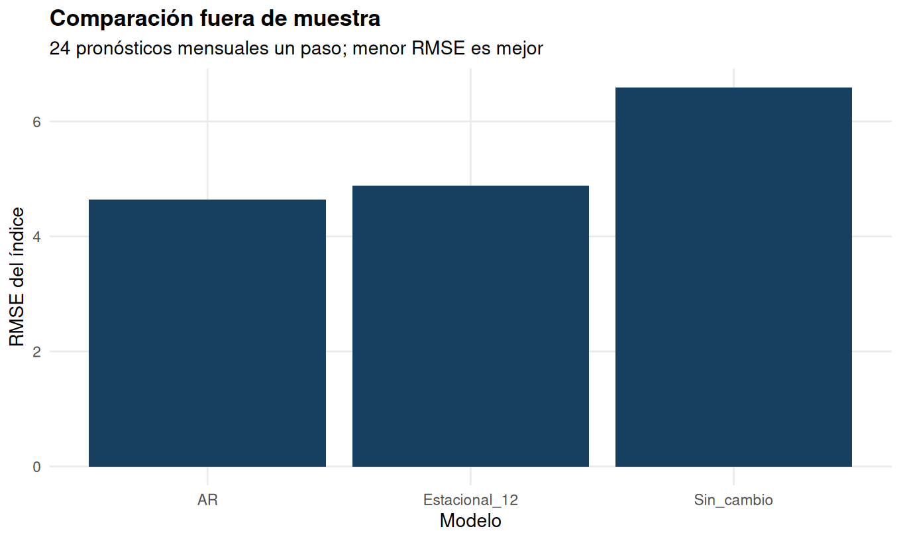

# Econometría aplicada en R

**Khoen San Martín · Ingeniería Comercial, mención Economía · Universidad Diego Portales**

Seis proyectos derivados de las entregas finales de Econometría II, segundo
semestre de 2025. Esta versión para portafolio ordena y corrige el código,
regenera resultados y documenta sus supuestos. Las entregas originales se
conservan por separado; esta revisión no sustituye ni modifica la evaluación
académica obtenida.

## Tres aplicaciones para empezar

| Aplicación | Trabajo realizado en R | Resultado y alcance |
|---|---|---|
| [Pronóstico manufacturero de Chile](proyectos/EE4/results/informe.md) | Preparación de 416 observaciones mensuales, selección AR con muestra comparable y evaluación temporal de 24 pronósticos | RMSE de 4,64 frente a 4,88 de la referencia estacional y 6,59 de persistencia. Comparación histórica; no garantiza rendimiento futuro. |
| [Concentración y tarifas aéreas](proyectos/EE3/results/report.md) | Panel de 4.596 observaciones y 1.149 rutas; MCO, RE, FE e inferencia agrupada por ruta | La asociación estimada para +10 puntos porcentuales de participación pasa de 3,67% en MCO a 1,70% en FE. Se distingue asociación de causalidad. |
| [Fertilidad y oferta laboral](proyectos/EE1/results/informe.md) | MCO y MC2E en 31.857 observaciones, primera etapa y diagnóstico de endogeneidad | Se distingue relevancia del instrumento de validez de exclusión. El intervalo convencional de la estimación IV incluye cero. |

Estas aplicaciones permiten revisar programación estadística, comparación de
modelos, cuantificación de incertidumbre e interpretación económica. EE2 añade
un diseño DiD con datos ficticios; EE5 y EE6 desarrollan dinámica temporal e
identificación de shocks.



La evaluación compara errores en una misma ventana de 24 meses: frente a la
referencia estacional, la reducción descriptiva del RMSE es aproximadamente
4,9%. No se presenta como una diferencia estadísticamente demostrada.

## Reproducción comprobada

Los seis análisis se ejecutaron en otra carpeta sin resultados ni cachés de
las bases públicas. Las 62 tablas CSV coinciden entre ejecuciones y las 14
referencias numéricas contrastadas concuerdan dentro del redondeo declarado.
El entorno verificado es R 4.3.3 en Linux.
[GitHub Actions también completó la restauración de dependencias y la ejecución
de los seis análisis y sus pruebas](https://github.com/stkoen/econometria-aplicada-r/actions/runs/40269256930).

## Proyectos

| Ejercicio | Pregunta y método | Informe generado |
|---|---|---|
| EE1 | Fertilidad y oferta laboral; MCO y variables instrumentales | [Informe](proyectos/EE1/results/informe.md) |
| EE2 | Anuncio de Metro y precios; diferencias en diferencias, datos ficticios | [Informe](proyectos/EE2/results/informe.md) |
| EE3 | Concentración y tarifas aéreas; modelos de panel | [Informe](proyectos/EE3/results/report.md) |
| EE4 | Pronóstico del IPM de Chile; modelos AR y evaluación temporal | [Informe](proyectos/EE4/results/informe.md) |
| EE5 | Shock petrolero y producción industrial; rezagos distribuidos y HAC | [Informe](proyectos/EE5/results/informe.md) |
| EE6 | Caso docente de Baldur; VAR, Granger, IRF y FEVD | [Informe](proyectos/EE6/results/informe.md) |

Son aplicaciones académicas revisadas de métodos estándar. Cada informe
identifica sus datos, supuestos y límites de interpretación.

## Ejecutar todo desde cero

Requisitos: R 4.3.3 o posterior compatible. Abrir este directorio como proyecto
RStudio o situarse en su raíz desde una terminal. La primera ejecución requiere
Internet para instalar paquetes y obtener las bases públicas de EE1 y EE3.
Las cuatro bases docentes se incluyen en `data/originales/`. Las dos XLSX son
copias con metadatos reducidos; sus celdas y valores no cambian. El manifiesto
distingue los archivos recibidos de estas copias de distribución.

```bash
Rscript --vanilla scripts/install_dependencies.R
Rscript --vanilla run_all.R
Rscript --vanilla tests/check_all.R
```

Ejecutar solo un bloque:

```bash
Rscript --vanilla run_all.R EE5
```

Las salidas se guardan en `proyectos/EE*/results/`. El programa comprueba los
hashes de distribución antes de leer las bases docentes, crea los directorios y no depende de
objetos guardados en una sesión anterior de R.

### Versiones utilizadas

`renv.lock` registra los paquetes de la ejecución verificada. Para restaurarlos:

```bash
Rscript --vanilla -e 'install.packages("renv", repos="https://cloud.r-project.org")'
Rscript --vanilla -e 'renv::restore(project=getwd(), library=renv::paths$library(project=getwd()), prompt=FALSE)'
Rscript --vanilla -e 'renv::load(); source("run_all.R")'
Rscript --vanilla -e 'renv::load(); source("tests/check_all.R")'
```

Algunos paquetes pueden necesitar compiladores y bibliotecas de desarrollo en
Linux. La ejecución comprobada usa Linux/Ubuntu y R 4.3.3. La restauración del
lockfile y la ejecución en GitHub Actions están comprobadas en Linux. La
instalación en Windows y macOS no se presenta como verificada.

## Qué se reproduce y qué se corrige

- Los coeficientes centrales publicados en EE1, los efectos DiD de EE2, los
  modelos y Hausman de EE3, el pronóstico original de EE4, el Wald de EE5 y
  coeficientes del VAR de EE6 se contrastan con referencias de las entregas.
- Las estimaciones convencionales se mantienen separadas de ampliaciones
  robustas, nuevas evaluaciones y especificaciones corregidas.
- EE4 distingue mediana/media tras transformar logaritmos y diferentes medidas
  de crecimiento anual; incorpora 24 evaluaciones temporales de un paso.
- EE5 documenta que el shock suministrado usa 36 meses, mientras la fórmula del
  enunciado usa 12; muestra ambas y una comparación sobre muestra común.
- EE6 produce las nueve IRF con identificación correcta de shock y respuesta.

[Cambios y límites](docs/CAMBIOS.md) · [Fuentes y datos](docs/FUENTES.md) ·
[Comprobaciones realizadas](docs/COMPROBACIONES.md) ·
[Matriz de referencias originales](docs/reproduccion_resumen.csv) ·
[Metadatos de distribución](docs/METADATOS.md) ·
[Correspondencia del EE4 con sus siete preguntas](proyectos/EE4/ENUNCIADO_Y_REVISION.md).

## Autoría y fuentes

Portafolio de Khoen San Martín, desarrollado a partir de los ejercicios de
Econometría II de la Universidad Diego Portales (2025), con enunciados de
Mauricio Tejada. Las fuentes de datos y el proceso de revisión se detallan en
[Fuentes y datos](docs/FUENTES.md) y [Cambios y límites](docs/CAMBIOS.md).
