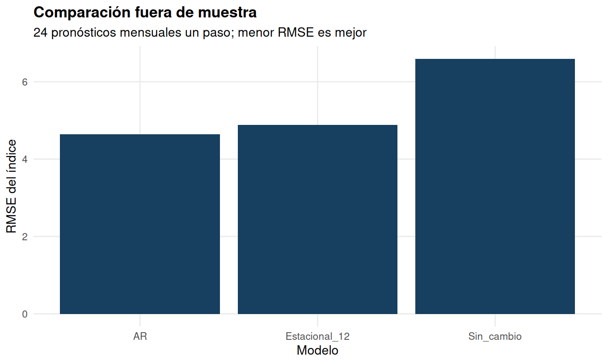

# Econometría aplicada en R

**Khoen San Martín · Ingeniería Comercial, mención Economía · Universidad Diego Portales**

Seis ejercicios académicos de Econometría II (2025), revisados en 2026. Incluyen preparación de datos, estimación, interpretación económica y generación de informes con R.

## Aplicaciones destacadas

| Aplicación | Métodos | Resultado principal |
|---|---|---|
| [Concentración y tarifas aéreas](proyectos/EE3/results/report.md) | MCO, efectos aleatorios y fijos; errores agrupados por ruta | Un aumento de 10 puntos porcentuales en participación se asocia con tarifas 3,67% mayores en MCO y 1,70% con efectos fijos. |
| [Pronóstico del IPM de Chile](proyectos/EE4/results/informe.md) | Modelos autorregresivos y evaluación temporal | RMSE de 4,64 en 24 pronósticos históricos, frente a 4,88 de la referencia estacional. |
| [Shock petrolero y producción industrial](proyectos/EE5/results/informe.md) | Rezagos distribuidos, pruebas de raíz unitaria e inferencia HAC | Comparación de dos definiciones del shock y estimación de respuestas acumuladas con intervalos de confianza. |



## Otros ejercicios

- [Fertilidad y oferta laboral](proyectos/EE1/results/informe.md): MCO, variables instrumentales y diagnóstico de primera etapa.
- [Anuncio de Metro y precios de vivienda](proyectos/EE2/results/informe.md): diferencias en diferencias con datos ficticios.
- [Dinámica macroeconómica](proyectos/EE6/results/informe.md): VAR, causalidad de Granger y funciones impulso-respuesta en un caso docente.

Cada informe documenta datos, supuestos y límites de interpretación. Las asociaciones estimadas y los contrastes de Granger se distinguen de efectos causales; los pronósticos se evalúan en su ventana histórica.

## Ejecución

Desde la raíz del repositorio:

```bash
Rscript --vanilla scripts/install_dependencies.R
Rscript --vanilla run_all.R
Rscript --vanilla tests/check_all.R
```

Para un solo ejercicio: `Rscript --vanilla run_all.R EE4`.

Entorno verificado: R 4.3.3 en Linux. `renv.lock` registra las versiones de paquetes. Las bases públicas de EE1 y EE3 se descargan en la primera ejecución; las restantes están en `data/originales/`.

## Documentación

[Fuentes y datos](docs/FUENTES.md) · [Revisión metodológica y herramientas de apoyo](docs/CAMBIOS.md) · [Comprobaciones de reproducibilidad](docs/COMPROBACIONES.md)

Los enunciados, datos y bibliotecas se atribuyen a sus respectivas fuentes.

Otro proyecto: [Detección de fraude con Machine Learning](https://github.com/stkoen/credit-card-fraud-detection-ml).
