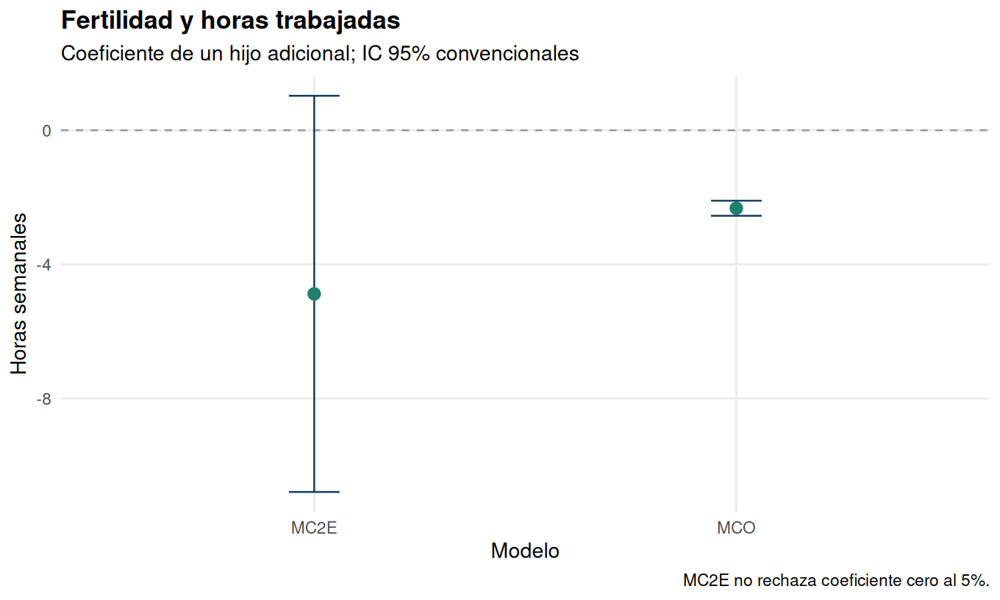

# EE1: fertilidad y oferta laboral femenina

Datos públicos labsup: 31.857 observaciones. La unidad de análisis es una mujer de la muestra; no se modela un panel.

## Estimaciones originales reproducidas

| model | estimate | std_error | p_value | lower95 | upper95 |
| --- | --- | --- | --- | --- | --- |
| MCO | -2.3258 | 0.1146 | 6.059e-91 | -2.5505 | -2.1011 |
| MC2E | -4.8789 | 3.0135 | 0.1055 | -10.7854 | 1.0276 |

`nonmomi` mide ingresos del hogar distintos de los de la madre, en miles de dólares. Se corrige la etiqueta errónea de inmigración de la entrega; se conserva la misma variable numérica.

## Relevancia e interpretación

| contrast | statistic | df1 | df2 | p_value |
| --- | --- | --- | --- | --- |
| F global primera etapa | 615.3710 | 7.0000 | 31849.0000 | 0.0000 |
| F instrumento excluido | 46.8758 | 1.0000 | 31849.0000 | 7.700e-12 |

El F global incluye todos los regresores de la primera etapa. El F del instrumento excluido evalúa samesex condicional en los controles y es el contraste pertinente de relevancia. Un F elevado no verifica exclusión ni independencia respecto del error estructural.

MCO estima una asociación negativa y precisa. MC2E entrega un coeficiente más negativo, pero su intervalo incluye cero. La diferencia entre estimadores no demuestra por sí sola el sentido del sesgo ni un efecto negativo causal confirmado.

Se calcula Wu–Hausman por función de control. Hay un instrumento excluido para una variable endógena: la ecuación está exactamente identificada y no existe un contraste de sobreidentificación informativo que pruebe la exclusión.

La interpretación causal de MC2E exige relevancia, exogeneidad y exclusión del instrumento, además de los supuestos de la especificación. Que el sexo de los hijos tenga un componente aleatorio no descarta un efecto directo de su composición sobre la oferta laboral. Con efectos heterogéneos y fertilidad discreta, el estimando puede depender de los márgenes modificados por el instrumento; no se presenta como efecto universal de la maternidad.

El modelo usa kids y hours, como la ecuación y la estimación instrumental del enunciado. La referencia de una pregunta a morekids y weeksm1 no cambia silenciosamente la especificación.

## Correspondencia con el curso

Se cubren descriptivos, MCO, discusión de endogeneidad, instrumento, primera etapa, MC2E y conclusiones. Los errores HC1 se exportan como análisis adicional. Se conserva la comparación convencional para reproducir las cifras entregadas.

Fuente: https://justinmshea.github.io/wooldridge/reference/labsup.html. Enunciado docente: Mauricio Tejada, Ejercicio Empírico 1: Margen Intensivo de la Participación Laboral Femenina.
