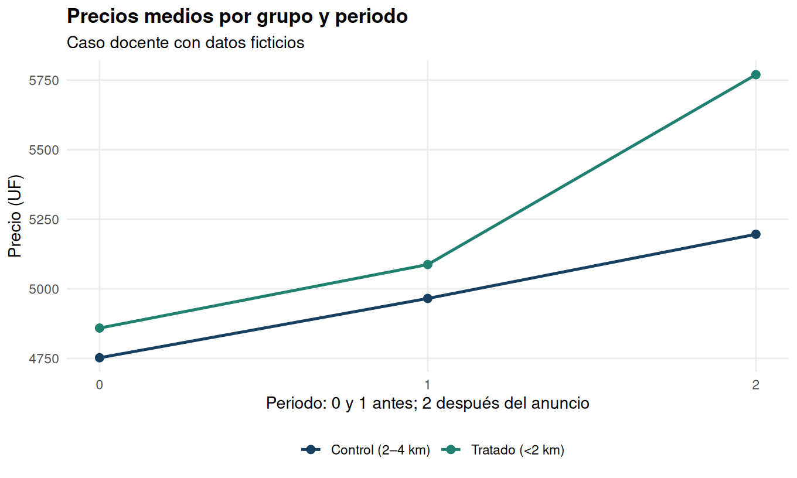

# EE2: anuncio de Metro y precios de viviendas

**Caso docente con datos ficticios.** El tratamiento del enunciado es el anuncio de una estación futura, no su apertura. No se presenta como evaluación de una intervención real.

El archivo recibido contiene 30.000 transacciones con identificadores únicos: 10.000 por periodo. El enunciado describe 3.000; se documenta la diferencia y se usa el archivo efectivamente proporcionado, sin recortar observaciones para forzar coincidencia.

## Diferencias en diferencias

| model | estimate | std_error | p_value | percent |
| --- | --- | --- | --- | --- |
| nivel_sin_controles | 451.7401 | 26.1675 | 2.685e-66 | NA |
| log_sin_controles | 0.0835 | 0.0051 | 5.035e-59 | 8.7129 |
| nivel_con_controles | 494.7104 | 2.8558 | 0.0000 | NA |
| log_con_controles | 0.0919 | 0.0008 | 0.0000 | 9.6280 |

Las estimaciones en logaritmos se convierten mediante 100*(exp(beta)-1). Corresponden a cambios proporcionales del nivel ajustado bajo esa especificación; no se equiparan automáticamente con el ATT sobre el promedio aritmético de precios.

## Identificación y comprobaciones

Los datos son cortes transversales repetidos, no observaciones repetidas de la misma vivienda. Se usa HC1 como en el script original. Al no existir unidades geográficas de asignación identificadas, no se inventa una agrupación por observación ni se pretende resolver correlación espacial desconocida.

El balance observable no demuestra asignación aleatoria y no es condición necesaria del DiD básico. El placebo pretratamiento no significativo es compatible con tendencias paralelas, pero no las demuestra; solo existe una variación previa observable. También importan ausencia de anticipación, estabilidad de composición y de interferencias, y ausencia de shocks diferenciales no observados.

En un DiD logarítmico, el supuesto de tendencias paralelas se plantea para log(precio), no se deduce de comprobarlo en niveles. La inclusión de controles no elimina automáticamente todas las fuentes de sesgo.

Las cinco preguntas se abordan con balance, gráfico de tendencias, DiD en niveles y logaritmos, y ambos modelos con controles. El placebo y el balance conjunto son ampliaciones documentadas.

## Cifras de la entrega y archivo recibido

| model | reference | reproduced | difference | matches |
| --- | --- | --- | --- | --- |
| log_con_controles | 9.6000 | 9.6280 | 0.0280 | TRUE |
| log_sin_controles | 8.7000 | 8.7129 | 0.0129 | TRUE |
| nivel_con_controles | 495.0000 | 494.7104 | -0.2896 | TRUE |
| nivel_sin_controles | 452.0000 | 451.7401 | -0.2599 | TRUE |

Las discrepancias, si aparecen, permanecen visibles. No se modifican datos ni coeficientes para obtener los números publicados.
