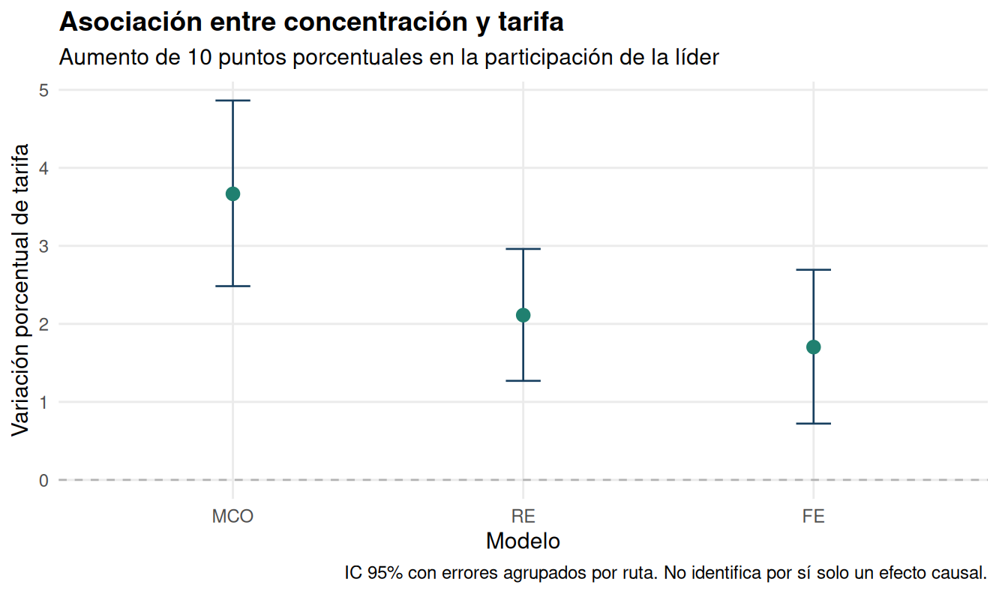

# Concentración y tarifas aéreas

**Khoen San Martín · Econometría II · Universidad Diego Portales**

Análisis de la asociación entre participación de la aerolínea líder y tarifa, comparando MCO agrupado, efectos aleatorios y efectos fijos. El panel contiene 1.149 rutas de Estados Unidos y 4.596 observaciones entre 1997 y 2000.

[Informe y resultados](results/report.md) · [Fuente y variables](docs/FUENTES.md)



Un aumento de 10 puntos porcentuales en participación se asocia con tarifas 3,67% mayores en MCO y 1,70% con efectos fijos. Los modelos incluyen efectos de año y los errores se agrupan por ruta. La interpretación es asociativa: pueden persistir simultaneidad y factores omitidos que varían en el tiempo.

## Ejecución

Desde este directorio, con R 4.3.3 y acceso a Internet para la descarga inicial:

```bash
Rscript --vanilla scripts/install_dependencies.R
Rscript --vanilla run.R
Rscript --vanilla tests/check_reproduction.R
```

Para restaurar las versiones registradas en `renv.lock`:

```bash
Rscript --vanilla -e 'install.packages("renv", repos="https://cloud.r-project.org")'
Rscript --vanilla -e 'renv::restore(prompt=FALSE)'
Rscript --vanilla -e 'renv::load(); source("run.R")'
Rscript --vanilla -e 'renv::load(); source("tests/check_reproduction.R")'
```

La base se descarga de una revisión fija, se valida por hash y se guarda como caché excluida de Git. La instalación en Linux puede requerir compilador y bibliotecas de desarrollo. El entorno utilizado está en `results/sessionInfo.txt`.

## Salidas principales

| Archivo | Contenido |
|---|---|
| `results/report.md` | Informe con resultados e interpretación |
| `results/concentration_effects.csv` | Coeficientes, errores e intervalos |
| `results/coefficients_cluster.csv` | Coeficientes completos con errores agrupados |
| `results/hausman_tests.csv` | Contraste clásico de Hausman |
| `results/pooled_ci_comparison.csv` | Inferencia usual, HC1 y agrupada |
| `results/figures/` | Gráficos generados |

## Documentación

Ejercicio académico de 2025, revisado en 2026. [Revisión metodológica](docs/REVISION.md) · [Comprobaciones](docs/COMPROBACIONES.md) · [Preguntas y resultados](docs/ENUNCIADO.md)

Las comprobaciones del conjunto de seis ejercicios se documentan en [la revisión general](../../docs/COMPROBACIONES.md).
