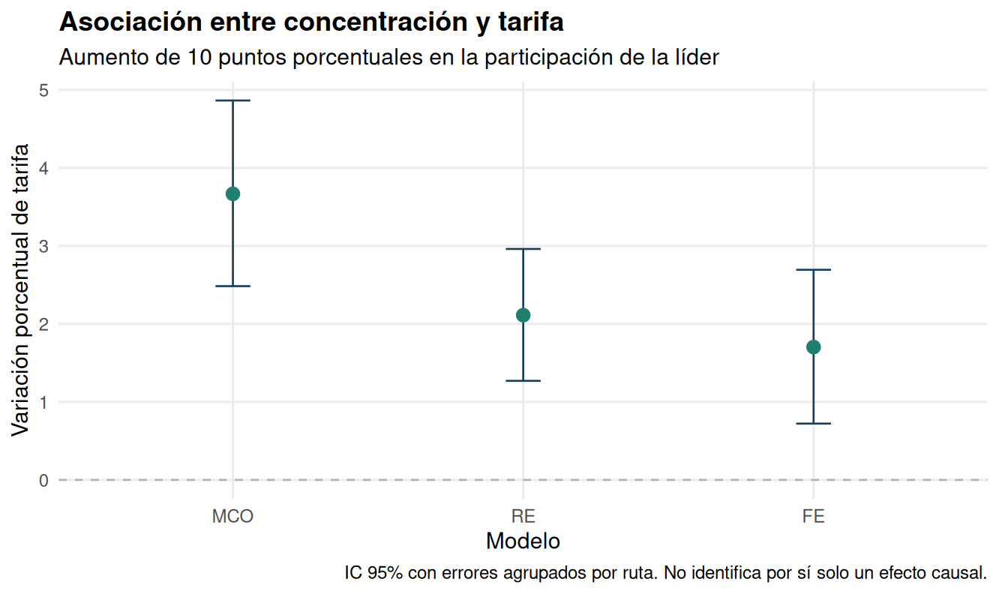

# Concentración y tarifas aéreas: resultados reproducidos

**Autor:** Khoen San Martín. Ejercicio académico de Econometría II, UDP, 2025; revisión para portafolio, 2026.

## Pregunta y datos

¿Cómo cambia la asociación estimada entre participación de la aerolínea líder y tarifa al controlar diferencias persistentes entre rutas?

Panel balanceado: 4.596 observaciones, 1.149 rutas y cuatro años (1997–2000). Tarifa media de ida en dólares nominales; participación de la líder entre 0 y 1; distancia en millas. Fuente: airfare del paquete wooldridge, originalmente U.S. Department of Transportation.

## Modelos e inferencia

MCO agrupado y RE incluyen participación, log(distancia), su cuadrado y efectos de año. FE incluye efectos de ruta y de año: la distancia, exactamente constante por ruta en estos datos, queda absorbida. RE usa Swamy–Arora.

Los intervalos usan covarianzas HC1 agrupadas por ruta. Se mantiene la inferencia t con los grados de libertad residuales del modelo; son muchos grupos (1.149). No se añade agrupación por año: solo se observan cuatro años.

## Asociación para un aumento de 10 puntos porcentuales

| Modelo | Coeficiente | EE agrupado | Cambio porcentual exacto | IC 95% |
|---|---:|---:|---:|---:|
| MCO | 0.3601 | 0.0585 | 3.67% | [2.48%; 4.86%] |
| RE | 0.2090 | 0.0422 | 2.11% | [1.27%; 2.96%] |
| FE | 0.1689 | 0.0494 | 1.70% | [0.72%; 2.69%] |

El cambio porcentual se calcula como `100 * (exp(0.10 * beta) - 1)`. Se interpreta como cambio proporcional del nivel ajustado derivado del modelo logarítmico; no como aumento porcentual del propio logaritmo ni como predicción incondicional de la tarifa media.

## Comparación de errores estándar en MCO

| Inferencia | Error estándar | IC 95% del coeficiente |
|---|---:|---:|
| Usual_MCO | 0.0301 | [0.3012; 0.4191] |
| HC1 | 0.0318 | [0.2977; 0.4225] |
| Agrupada_ruta | 0.0585 | [0.2454; 0.4749] |

La inferencia usual presupone errores esféricos. HC1 admite heterocedasticidad; la agrupación por ruta también admite dependencia arbitraria entre observaciones de una misma ruta. Cambia la incertidumbre reportada, no el coeficiente de MCO.

La transformación RE tiene theta (lambda en el enunciado) = 0.8355. Un valor cercano a uno hace que el cuasidesvío de medias de RE se aproxime a la transformación within de FE; no demuestra por sí solo que RE sea consistente.

## Contrastes de especificación

Hausman clásico: chi-cuadrado = 9.9967, gl = 4, p = 0.04048.

El clásico reproduce el contraste de la entrega y se interpreta bajo sus supuestos convencionales. Los errores agrupados de los coeficientes no convierten automáticamente este contraste en robusto. No se verifica exogeneidad frente a todas las fuentes de endogeneidad ni se identifica causalidad.

## Distancia

En MCO, la parábola en log(distancia) tiene su mínimo en 79.5 millas, fuera del rango observado (95–2.724). La elasticidad parcial estimada es positiva en ese rango. El vértice es un mínimo, no un punto de inflexión; la convexidad en coordenadas logarítmicas no implica convexidad del precio en niveles.

## Reproducción y alcance

Los tres coeficientes de concentración y el Hausman clásico coinciden con los publicados en 2025 dentro del redondeo indicado en `reproduction_original.csv`. Esto reproduce resultados puntuales de la entrega; no certifica cada frase o gráfico del PDF original.

FE controla características de ruta invariantes y los efectos de año capturan shocks anuales comunes. Permanecen posibles factores omitidos que cambian por ruta y año, simultaneidad entre tarifas y concentración y error de medición. La lectura defendible es una asociación condicionada, sin un efecto causal demostrado.

Dos ejemplos de heterogeneidad fija potencialmente correlacionada con concentración son la condición persistente de conexión con un aeropuerto-hub y la disponibilidad persistente de alternativas de transporte terrestre. Su tratamiento como invariante se refiere a la ventana observada.

Es una aplicación docente sobre una base histórica conocida. No se presenta como investigación original ni como evidencia sobre el mercado chileno actual.

## Archivos

Tablas completas en CSV, figuras PNG y `sessionInfo.txt` se generan con `Rscript --vanilla run.R`. Fuentes, revisión y correspondencia con las ocho preguntas: `../docs/FUENTES.md`, `../docs/REVISION.md` y `../docs/ENUNCIADO.md`.
