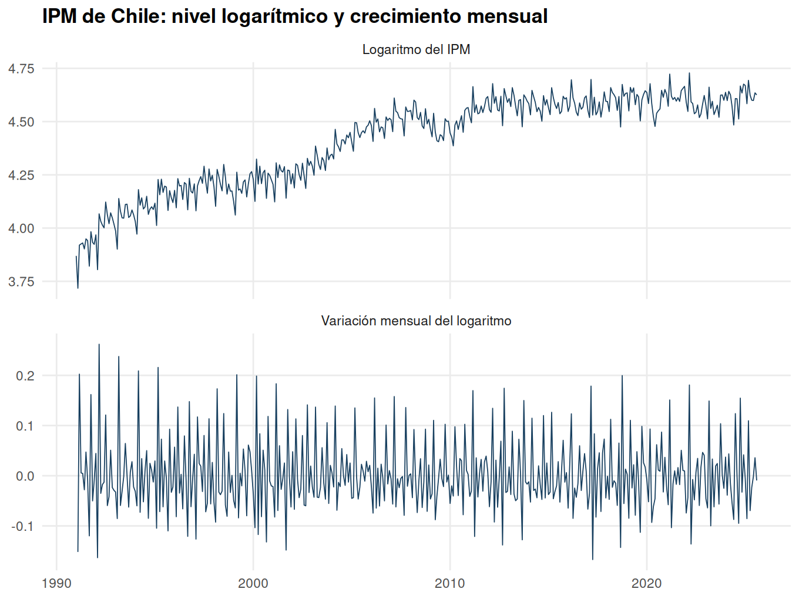
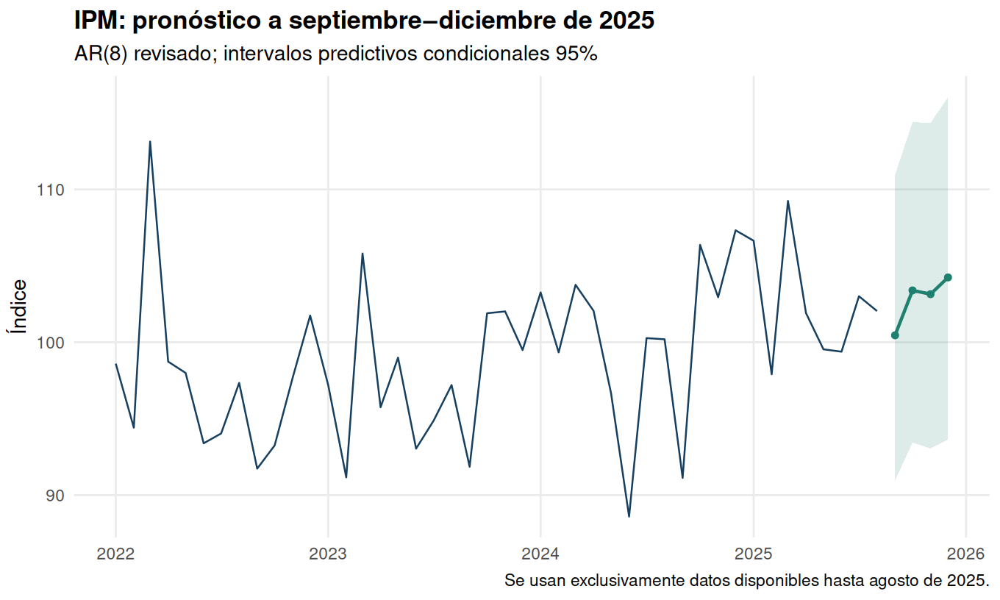

# EE4: pronóstico del IPM de Chile

Khoen San Martín. Versión revisada para portafolio; entrega académica original de octubre de 2025.

Base original de 416 meses, enero de 1991 a agosto de 2025. Las fechas se leen y verifican; no se asignan periodos sin comprobar la columna Fecha. Se pronostican septiembre–diciembre de 2025 desde ese corte histórico.

## Base, descriptivos y pregunta 1: patrones temporales

| variable | n | mean | sd | min | max |
| --- | --- | --- | --- | --- | --- |
| IPM | 416 | 83.7647 | 16.6621 | 41.1611 | 113.1287 |
| log_IPM | 416 | 4.4062 | 0.2149 | 3.7175 | 4.7285 |
| dlog_IPM | 415 | 0.0018 | 0.0729 | -0.1671 | 0.2620 |

Se define lipm como el logaritmo del índice y dlog como su primera diferencia. El nivel logarítmico muestra variaciones de largo plazo y la diferencia oscila alrededor de una media más estable, con movimientos estacionales y episodios de volatilidad. Un gráfico no demuestra estacionariedad ni identifica por sí solo las causas de las caídas.

## Pregunta 2: AR(1)–AR(8) y selección corregida

| p | n_common | AIC_common | n_original | AIC_original_variable_sample |
| --- | --- | --- | --- | --- |
| 1 | 407.0000 | -1112.9574 | 414.0000 | -1127.4213 |
| 2 | 407.0000 | -1170.1812 | 413.0000 | -1184.7502 |
| 3 | 407.0000 | -1186.5589 | 412.0000 | -1199.9605 |
| 4 | 407.0000 | -1217.9989 | 411.0000 | -1227.3762 |
| 5 | 407.0000 | -1231.6306 | 410.0000 | -1236.8403 |
| 6 | 407.0000 | -1252.2169 | 409.0000 | -1258.5551 |
| 7 | 407.0000 | -1256.7642 | 408.0000 | -1259.2185 |
| 8 | 407.0000 | -1261.5537 | 407.0000 | -1261.5537 |

Los ocho modelos se estiman también mediante dynlm, como pide el enunciado, y AIC. verificacion_dynlm.csv comprueba la coincidencia de coeficientes y AIC con la construcción explícita de rezagos. La ventana común evita comparar criterios de muestras diferentes; la tabla mantiene el cálculo de muestras variables de la entrega.

Con ventana común se selecciona AR(8). El procedimiento de muestras variables del script original selecciona AR(8). Un menor AIC no implica que cada rezago incluido sea individualmente significativo.

Se usa MCO condicional tanto para selección como para la estimación revisada y su pronóstico. La reconstrucción original se mantiene separada porque reestima mediante arima después de seleccionar por MCO. El modelo automático ar usa por defecto Yule–Walker, una tercera forma de estimar; no se confunden diferencias numéricas entre métodos con errores.

## Pregunta 3: prueba F de significancia conjunta

| test | n | F | df1 | df2 | p_value |
| --- | --- | --- | --- | --- | --- |
| Todos los rezagos de AR(8) | 407 | 53.2843 | 8.0000 | 398.0000 | 2.274e-58 |
| Todos los rezagos de AR(6) | 409 | 67.6049 | 6.0000 | 402.0000 | 6.572e-58 |
| Rezagos 1 a 6 dentro de AR(8) | 407 | 61.9667 | 6.0000 | 398.0000 | 4.605e-54 |

El contraste F habitual tiene como nula que todos los coeficientes de los rezagos evaluados son cero; la alternativa es que al menos uno sea distinto de cero. La redacción del enunciado invierte esa nula y menciona seis rezagos aun cuando el orden seleccionado puede ser ocho. Por eso se identifica el contraste principal del modelo elegido y se muestran las dos lecturas de la referencia a seis rezagos. Son pruebas convencionales condicionales al orden seleccionado: requieren los supuestos del modelo y no ajustan por selección previa mediante AIC. Rechazar no demuestra que todos los rezagos sean individualmente significativos ni garantiza precisión fuera de muestra.

## Preguntas 4 y 5: pronósticos de crecimiento y nivel

| date | pred_dlog | lower95_dlog | upper95_dlog | log_level | level_median | level_mean_lognormal | lower95_level | upper95_level |
| --- | --- | --- | --- | --- | --- | --- | --- | --- |
| 2025-09-01 | -0.0157 | -0.1150 | 0.0837 | 4.6097 | 100.4552 | 100.5843 | 90.9558 | 110.9468 |
| 2025-10-01 | 0.0288 | -0.0987 | 0.1563 | 4.6385 | 103.3915 | 103.5294 | 93.4389 | 114.4041 |
| 2025-11-01 | -0.0024 | -0.1299 | 0.1251 | 4.6362 | 103.1470 | 103.2895 | 93.0511 | 114.3382 |
| 2025-12-01 | 0.0105 | -0.1174 | 0.1385 | 4.6467 | 104.2408 | 104.3971 | 93.6363 | 116.0463 |

Se distinguen mediana transformada y media bajo supuesto lognormal. Exponenciar el pronóstico logarítmico no produce automáticamente la media aritmética. Los intervalos predictivos propagan las innovaciones, incluidas las covarianzas al acumular crecimientos, y tratan los parámetros estimados como fijos.

## Comprobación temporal

| model | n | MAE | RMSE |
| --- | --- | --- | --- |
| AR | 24 | 3.6482 | 4.6387 |
| Sin_cambio | 24 | 5.1821 | 6.5903 |
| Estacional_12 | 24 | 3.9899 | 4.8786 |

En cada uno de los 24 orígenes finales se selecciona y estima usando solo información pasada. Se compara contra persistencia y contra índice del mismo mes del año anterior. No se elige el modelo con estos errores y se presenta luego la misma ventana como prueba independiente; los resultados describen esta evaluación histórica y no garantizan rendimiento futuro.

La serie no fue desestacionalizada en la entrega y los candidatos llegan a ocho rezagos. El contraste con una referencia estacional a 12 meses es relevante. Una ampliación SARIMA o con dummies mensuales requiere evaluación temporal adicional; no se atribuye robustez general al AR por su significancia dentro de muestra.

## Pregunta 6: crecimiento interanual y promedio de 2025

| measure | value |
| --- | --- |
| Promedio mensual de variaciones interanuales log 2025 | 0.0249 |
| Diciembre 2025 versus diciembre 2024 (%) | -2.8733 |
| Promedio índice 2025 versus promedio 2024 (%) | 2.4120 |

El promedio de tasas interanuales mensuales, la variación diciembre/diciembre y la variación de promedios anuales no son la misma medida. Los valores de 2025 combinan ocho meses observados y cuatro pronosticados.

La primera fila responde a la pregunta: media de las doce diferencias logarítmicas interanuales de 2025. Multiplicarla por 100 da una aproximación porcentual. crecimiento_interanual_serie_completa.csv contiene la serie completa y distingue los meses predichos.

## Pregunta 7: comparación con ar y forecast

| date | manual_MCO | automatic_YW | lower95_YW | upper95_YW | selected_order | difference_YW_minus_MCO |
| --- | --- | --- | --- | --- | --- | --- |
| 2025-09-01 | -0.0157 | -0.0151 | -0.1158 | 0.0856 | 8 | 0.0006 |
| 2025-10-01 | 0.0288 | 0.0294 | -0.1000 | 0.1588 | 8 | 0.0006 |
| 2025-11-01 | -0.0024 | -0.0025 | -0.1319 | 0.1269 | 8 | -0.0001 |
| 2025-12-01 | 0.0105 | 0.0097 | -0.1201 | 0.1395 | 8 | -0.0008 |

Se ejecutan ar con order.max=8 y selección AIC, y forecast con h=4 y level=95. El ejemplo del enunciado incluye un punto sintáctico sobrante, usa tres pasos y deja order.max=12 como ejemplo: se adapta al horizonte de cuatro meses solicitado. El AIC relativo de ar se guarda por separado; incluye AR(0) y no es el AIC absoluto de las regresiones dynlm. ar utiliza Yule–Walker por defecto y su selección y estimación no son idénticas a MCO. La cercanía de pronósticos se evalúa en la tabla, sin exigir igualdad entre estimadores.

## Entrega original

| statistic | reference | reproduced | tolerance | difference | matches |
| --- | --- | --- | --- | --- | --- |
| IPM diciembre 2025 por procedimiento original | 104.2800 | 104.2817 | 0.0200 | 0.0017 | TRUE |

Se documentan por separado discrepancias de transcripción entre logaritmos y niveles. Se contrastaron las siete preguntas con el enunciado del IPM y las instrucciones generales. La evaluación temporal y la distinción entre media y mediana son ampliaciones de portafolio.

Estabilidad del AR revisado: TRUE, comprobada con raíces fuera del círculo unidad.

## Conclusión y reflexión

El AR(8) resume dependencia temporal del crecimiento y entrega un índice de diciembre cercano a 104.24 al exponenciar el pronóstico logarítmico. La evaluación histórica de 24 meses permite comparar su error con referencias simples. El promedio de tasas interanuales de 2025 no debe presentarse como crecimiento diciembre/diciembre. La principal lección es mantener comparables las muestras y los estimadores, precisar la hipótesis F y distinguir evidencia dentro y fuera de muestra.

Fuentes: base y enunciado de Mauricio Tejada, UDP, Econometría II 2025-S2. Código reproducible en ../analysis.R; trazabilidad y asistencia declaradas en el README general.
