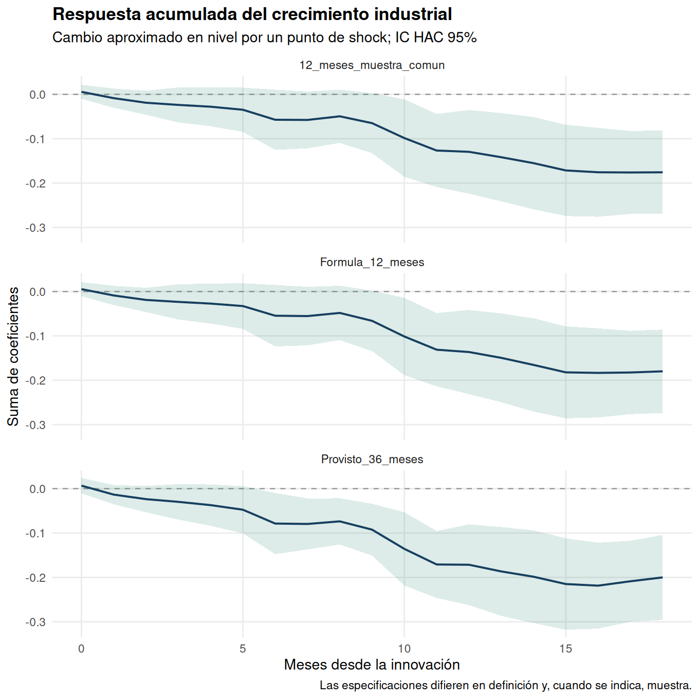

# EE5: shock petrolero y producción industrial

La base tiene 708 meses, enero de 1955 a diciembre de 2013. La mención de una contracción de 2020 en la entrega no corresponde a esta muestra y se retira.

## Diferencia entre archivo y enunciado

| window_months | compared | max_abs_difference | mismatches |
| --- | --- | --- | --- |
| 12.0000 | 672 | 13.5496 | 41 |
| 36.0000 | 672 | 3.553e-15 | 0 |

La columna 0_T coincide con aumentos netos sobre el máximo de los 36 meses anteriores, no de los 12 meses de la fórmula del enunciado. Los 36 NA iniciales se conservan como observaciones no calculables; no se sustituyen por cero. Se reproduce la medida suministrada y se añade la fórmula de 12 meses sobre muestra completa y sobre la misma muestra de la entrega.

## Raíz unitaria

| series | p | tau | critical_5pct | reject_unit_root_5pct |
| --- | --- | --- | --- | --- |
| log nivel | 12 | -1.7522 | -3.4100 | FALSE |
| crecimiento | 11 | -7.8352 | -2.8600 | TRUE |

Se corrige el conteo de parámetros del AIC y se comparan órdenes 0–12 sobre una misma ventana. El test seleccionado se reestima con las observaciones disponibles para ese orden. No rechazar la raíz unitaria no demuestra que la serie sea I(1); se evalúa conjuntamente la evidencia en diferencias. Los valores críticos son ADF, no t convencionales.

## Modelo DL(0–18) e inferencia

| specification | n | start | end | F_HAC | df1 | df2 | p_value |
| --- | --- | --- | --- | --- | --- | --- | --- |
| Provisto_36_meses | 654 | 1959-07-01 | 2013-12-01 | 5.2310 | 19 | 634 | 7.754e-12 |
| Formula_12_meses | 678 | 1957-07-01 | 2013-12-01 | 2.1597 | 19 | 658 | 0.0030 |
| 12_meses_muestra_comun | 654 | 1959-07-01 | 2013-12-01 | 2.1338 | 19 | 634 | 0.0035 |

Se usan covarianzas Newey–West con 18 rezagos y sin preblanqueo, como en la entrega. El Wald contrasta que los 19 coeficientes sean conjuntamente cero. La significancia de ese contraste no equivale a probar que su suma sea distinta de cero.

Cada beta mide puntos porcentuales de crecimiento mensual industrial por un punto de la medida de shock. La suma hasta h aproxima el cambio porcentual del nivel de producción acumulado hasta ese horizonte ante un shock puntual. Sus intervalos incorporan todas las covarianzas entre coeficientes; no se suman errores estándar.

## Exogeneidad: pregunta 6 del enunciado

Si una mayor actividad de Estados Unidos eleva el precio del petróleo, la medida petrolera puede correlacionarse con perturbaciones de la producción industrial. El modelo DL no identifica por sí solo efectos causales; HAC corrige la inferencia frente a heterocedasticidad y autocorrelación, no la endogeneidad. También pueden existir variables omitidas y heterogeneidad entre shocks de oferta y demanda petrolera.

## Reproducción de la entrega

| statistic | reference | reproduced | tolerance | difference | matches |
| --- | --- | --- | --- | --- | --- |
| F conjunto HAC, shock provisto | 5.2300 | 5.2310 | 0.0100 | 0.0010 | TRUE |

Fuente docente: Mauricio Tejada, Ejercicio Empírico 5: El Impacto de los Shocks en el Precio del Petróleo. La última pregunta y la fórmula de 12 meses se incorporan explícitamente. Archivo fuente: oil_shocks.xlsx, conservado por hash.
