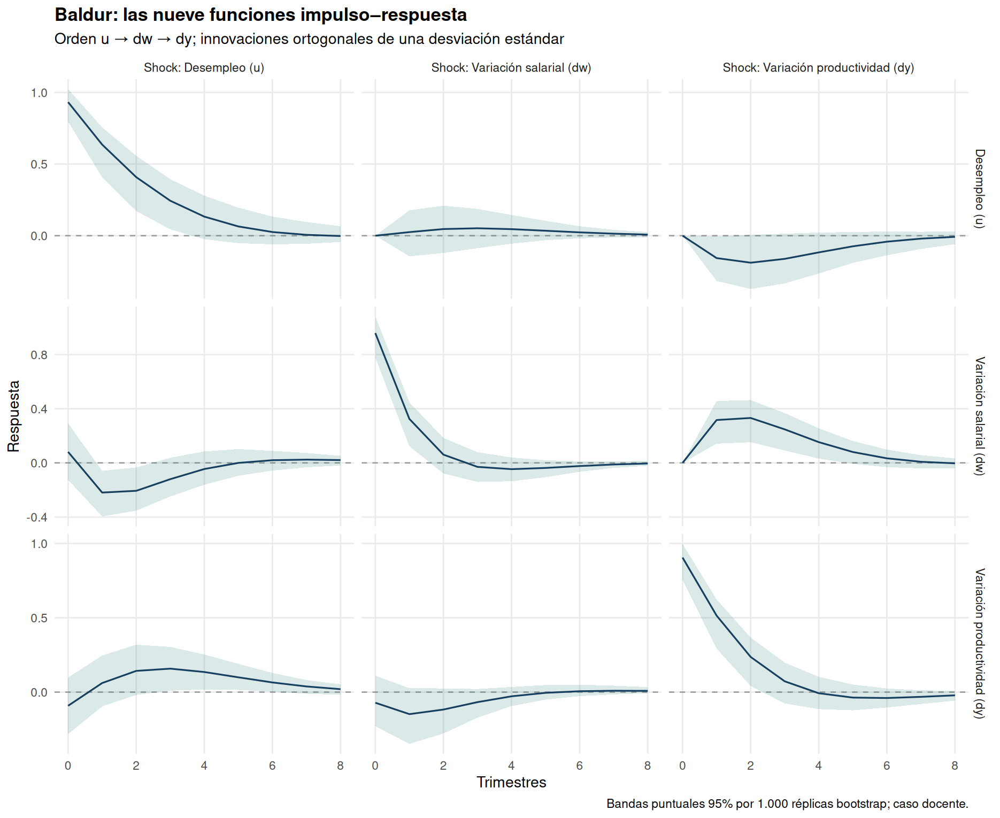

# EE6: VAR del caso docente de Baldur

100 observaciones trimestrales, 1995–2019. El enunciado entrega las variaciones de salarios y productividad como cambios porcentuales y declara las diferencias estacionarias y las series desestacionalizadas. No se presentan primeras diferencias arbitrarias como tasas de crecimiento ni se atribuye la estacionariedad a una comprobación visual.

## Datos y alcance

| variable | minimum | maximum | negatives |
| --- | --- | --- | --- |
| u | -2.4956 | 3.8593 | 37 |
| dw | -3.0105 | 3.8857 | 51 |
| dy | -2.5098 | 2.8727 | 42 |

La serie llamada desempleo contiene valores negativos. No puede interpretarse literalmente como una tasa bruta real sin aclaración adicional de su construcción. Se conserva el archivo docente sin recortes ni desplazamientos y se limita la lectura a este sistema estilizado.

## Selección, coeficientes y estabilidad

| p | AIC.n. | HQ.n. | SC.n. | FPE.n. |
| --- | --- | --- | --- | --- |
| 1 | -0.2811 | -0.1523 | 0.0374 | 0.7551 |
| 2 | -0.1723 | 0.0531 | 0.3851 | 0.8423 |
| 3 | -0.1780 | 0.1440 | 0.6183 | 0.8388 |

El orden seleccionado es 1 y el máximo módulo de autovalor de la matriz compañera es 0.6056 (<1).

## Identificación contemporánea

Se mantiene el orden solicitado u, dw, dy. En la convención Cholesky de vars, la primera variable no responde contemporáneamente a innovaciones de las siguientes: la primera es la más exógena contemporáneamente bajo esa restricción. La descripción del enunciado de primera variable como más endógena no coincide con esta convención. Se documenta, sin invertir silenciosamente el orden. La comparación con dy, dw, u permite observar sensibilidad a otra identificación.

## Nueve respuestas, correctamente identificadas

Se corrige la extracción: cada elemento de la lista es un shock y cada columna una respuesta. Ahora se exportan las nueve combinaciones. La innovación ortogonal tiene una desviación estándar; no es necesariamente un aumento de una unidad de la variable observada. Las bandas son puntuales, no simultáneas para todas las curvas y horizontes.

Una respuesta que se disipa en la tasa de crecimiento no implica que desaparezca el efecto acumulado sobre el nivel. Tampoco una respuesta persistente durante ocho trimestres demuestra un efecto permanente.

## Causalidad de Granger

| cause | response | F | df1 | df2 | p_value |
| --- | --- | --- | --- | --- | --- |
| dw | u | 0.0260 | 1.0000 | 95.0000 | 0.8723 |
| dy | u | 4.1825 | 1.0000 | 95.0000 | 0.0436 |
| u | dw | 8.5806 | 1.0000 | 95.0000 | 0.0043 |
| dy | dw | 16.1074 | 1.0000 | 95.0000 | 0.0001 |
| u | dy | 3.0409 | 1.0000 | 95.0000 | 0.0844 |
| dw | dy | 1.9621 | 1.0000 | 95.0000 | 0.1645 |

Se exportan seis direcciones condicionadas en la tercera variable y, por separado, los tres contrastes conjuntos del script original. Rechazar un contraste conjunto no demuestra significancia en cada ecuación individual. Granger mide contenido predictivo incremental; no identifica causalidad estructural.

## Varianza del error de predicción

| response | shock | horizon | share |
| --- | --- | --- | --- |
| u | u | 8 | 0.9288 |
| u | dw | 8 | 0.0058 |
| u | dy | 8 | 0.0654 |
| dw | u | 8 | 0.0791 |
| dw | dw | 8 | 0.7123 |
| dw | dy | 8 | 0.2086 |
| dy | u | 8 | 0.0709 |
| dy | dw | 8 | 0.0359 |
| dy | dy | 8 | 0.8931 |

Las participaciones se verifican para sumar uno por variable y horizonte. Su interpretación depende del orden de identificación y se limita a la varianza del error de pronóstico del modelo.

## Cifras originales reproducidas

| equation | term | reference | estimate | tolerance | difference | matches |
| --- | --- | --- | --- | --- | --- | --- |
| dw | dy.l1 | 0.3500 | 0.3498 | 0.0010 | -0.0002 | TRUE |
| dy | dy.l1 | 0.5680 | 0.5685 | 0.0010 | 0.0005 | TRUE |
| u | u.l1 | 0.6640 | 0.6639 | 0.0010 | -0.0001 | TRUE |

Fuente docente: Mauricio Tejada, Ejercicio Empírico 6: El Mercado Laboral de la Economía de Baldur. La corrección de gráficos afecta las interpretaciones gráficas; no modifica los coeficientes del VAR reducido.
